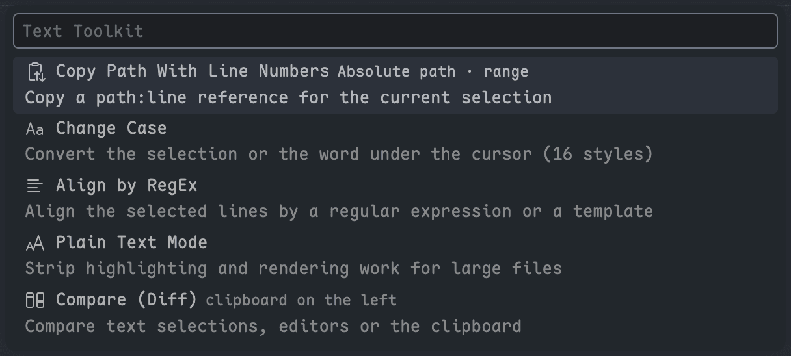

# Find commands and bind keys

**English** · [简体中文](../zh/docs/commands-and-keybindings.md)

This page shows how to reach every editor action from one picker and how to bind keys to the ones you use; the only keys bound by default are Cmd+U and Cmd+Y in the macOS terminal, so nothing else collides with your existing bindings.

## Use the two-level picker

`Text Toolkit: Show All Commands` lists the five tools, each with the settings currently in effect. Picking one opens its actions:

| Tool                        | Actions                                                                                                                                                                  |
| --------------------------- | ------------------------------------------------------------------------------------------------------------------------------------------------------------------------ |
| Copy Path With Line Numbers | Copy with the current setting, or with any of the four path styles as a one-off                                                                                          |
| Change Case                 | The 16 styles, previewed when the selection is a single line                                                                                                             |
| Align by RegEx              | `Enter a regular expression...`, plus every saved template with its pattern                                                                                              |
| Plain Text Mode             | Enable or Disable, whichever applies, and re-enable the large file prompt                                                                                                |
| Compare (Diff)              | Mark, compare with the mark, the clipboard, visible editors or two tabs, swap sides, edit as a copy, open the source file, toggle rules, clean up copies, clear the mark |

The second level always starts with `← Back`, `Esc` cancels without changing anything, and the first level never runs an action by itself.



## Bind keys with arguments

Every command accepts a keybinding, including the ones hidden from the Command Palette. Three take an argument that skips their picker:

| Command ID                      | Argument                                                                        |
| ------------------------------- | ------------------------------------------------------------------------------- |
| `textToolkit.copyPathWithLines` | `{ "pathStyle": "absolute" \| "relative" \| "tilde" \| "fileName" }`            |
| `textToolkit.changeCase`        | `{ "style": "camel" }`, or any of the [16 styles](change-case.md#the-16-styles) |
| `textToolkit.alignByRegex`      | `{ "regex": "=" }` or `{ "template": "assign" }`                                |

Add bindings to `keybindings.json` (`Preferences: Open Keyboard Shortcuts (JSON)`):

```json
[
	{ "key": "shift+alt+c", "command": "textToolkit.copyPathWithLines", "when": "editorTextFocus" },
	{
		"key": "shift+alt+p",
		"command": "textToolkit.copyPathWithLines",
		"args": { "pathStyle": "absolute" },
		"when": "editorTextFocus"
	},
	{
		"key": "ctrl+alt+k",
		"command": "textToolkit.changeCase",
		"args": { "style": "kebab" },
		"when": "editorTextFocus"
	},
	{
		"key": "ctrl+alt+a",
		"command": "textToolkit.alignByRegex",
		"args": { "template": "assign" },
		"when": "editorHasSelection"
	},
	{ "key": "ctrl+alt+t", "command": "textToolkit.commands" },
	{ "key": "ctrl+1", "command": "textToolkit.diff.markSelection", "when": "editorTextFocus" },
	{ "key": "ctrl+2", "command": "textToolkit.diff.compareWithMarked", "when": "editorTextFocus" },
	{
		"key": "ctrl+3",
		"command": "textToolkit.diff.compareWithClipboard",
		"when": "editorTextFocus"
	},
	{
		"key": "ctrl+alt+o",
		"command": "textToolkit.terminal.openSelection",
		"when": "terminalFocus"
	}
]
```

On macOS, Cmd+U already runs `textToolkit.terminal.openSelection` and Cmd+Y runs `textToolkit.terminal.openClipboardPath` in the terminal. The terminal passes keys to the shell unless they use Cmd on macOS, so a terminal binding such as `ctrl+alt+o` for either command also needs `terminal.integrated.commandsToSkipShell`; see [Bind a key](open-terminal-selection.md#bind-a-key).

## Find the commands that are not in the Command Palette

Eight commands stay out of the Command Palette because they need a file to act on or are rarely used; they are reachable here instead:

| Command                                                                                                     | Where                                                                 |
| ----------------------------------------------------------------------------------------------------------- | --------------------------------------------------------------------- |
| Open in Plain Text Mode                                                                                     | Explorer right-click on files                                         |
| Compare Text in Visible Editors, Compare Text in Two Open Tabs, Swap Diff Sides, Toggle Normalization Rules | Compare (Diff) picker                                                 |
| Edit This Comparison as a Copy                                                                              | `✎` in the diff editor title bar, Compare (Diff) picker               |
| Open the Source File                                                                                        | Go-to-file button in the diff editor title bar, Compare (Diff) picker |
| Show Compare Menu                                                                                           | The Compare status bar item                                           |

The editor's right-click menu has `Copy Path With Line Numbers` and `Select Text for Compare`, plus `Compare Text with Marked Selection` once something is marked; `textToolkit.diff.contextMenu` controls the two compare entries.

The terminal's right-click menu has `Open Terminal Selection as Path` while text is selected. The same command is in the Command Palette once a terminal is open, and `Open Clipboard as Path in Terminal Folder` is always there; neither is in the two-level picker; see [Open a terminal selection as a path](open-terminal-selection.md).
