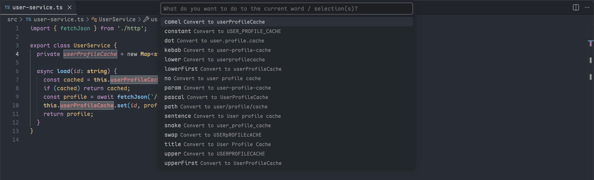

# Editor Text Toolkit

[English](../README.md) · **简体中文**

> 扩展市场页只显示英文版 README；扩展界面会跟随 VS Code 的显示语言切换为中文。

复制 `path:12-14` 形式的位置引用，转换大小写风格，按正则对齐各列，以纯文本模式打开大文件，比较任意两段文本。

[](https://marketplace.visualstudio.com/items?itemName=HeavenSky.editor-text-toolkit)
[](https://marketplace.visualstudio.com/items?itemName=HeavenSky.editor-text-toolkit)
[](../LICENSE.txt)

如果你每天都要把代码位置贴进评审和聊天、改标识符写法、比对代码片段，这个扩展就是为你做的。不必为每件事各装一个扩展：一个选择器列出全部动作，旁边标着当前生效的设置，不用记任何命令名。默认不绑定快捷键，没有运行时依赖，也不收集遥测数据。


## 快速开始

1. 执行 `code --install-extension HeavenSky.editor-text-toolkit`，或从 [VS Code 扩展市场](https://marketplace.visualstudio.com/items?itemName=HeavenSky.editor-text-toolkit)安装。
2. 按 `Ctrl+Shift+P`（macOS 上是 `Cmd+Shift+P`），执行 `文本工具箱: 显示全部命令`。
3. 先选工具，再选动作。用熟之后再给常用的动作[绑定快捷键](docs/commands-and-keybindings.md#带参数绑定快捷键)。

## 分享精确的代码位置

`复制路径与行号` 把所有光标和选区合成一条引用，同事、issue 系统和 AI 助手都能据此找回确切的行。选中第 3–4、8、12–14 行时复制出：

```text
src/app.ts:3-4,8,12-14
```

路径可以是绝对路径、工作区相对路径、以 `~` 开头的路径，或只有文件名。详见[复制路径与行号](docs/copy-path.md)。

## 就地改写和对齐文本

`转换大小写风格...` 把选区或光标所在的词转换成 16 种风格之一；选区只有一行时，确认前会预览每种结果。



`按正则对齐` 按任意分隔符对齐选中的行，较短的行不会撑宽它够不到的列：

```text
# 对齐前                # 对齐后
const a = 1;            const a  = 1;
let bbbb = 22;          let bbbb = 22;
var cc = 333;           var cc   = 333;
```

详见[转换大小写风格](docs/change-case.md)与[按正则对齐](docs/align-by-regex.md)。

## 打开大日志不卡编辑器

纯文本模式把文件切换为 `plaintext`，并只对纯文本关闭语法高亮、minimap、折叠、悬停提示和自动补全。**代码文件的设置保持不变。** 从资源管理器打开大的 `.ts` 文件时，不会拉起 TypeScript 扩展；退出模式会还原语言和改过的每一项设置。详见[以纯文本模式打开大文件](docs/plain-text-mode.md)。

## 不存文件也能比较两段文本

先标记一段选区，再拿它和另一段选区、剪贴板、可见编辑器或任意已打开的标签页比较。结果显示在 VS Code 自带的 diff 编辑器里，每一侧沿用来源文件的语言高亮。


归一化规则能屏蔽时间戳、制表符这类可预期的噪声；点一下就能把比较结果变成可编辑的副本。详见[比较两段文本](docs/compare.md)。

## 不适用的场景

纯文本模式省掉的是渲染和语言服务的开销，省不掉加载文件本身的开销：几百 MB 的文件仍会整个读进内存，这种文件请用 `less` 这类分页查看器。要比较磁盘上的两个完整文件并保留 Git 集成，VS Code 内置的 `选择以进行比较` 就够了。

## 延伸阅读

[使用指南](docs/README.md)覆盖全部选项、限制和提示信息。命令与设置清单见扩展市场页的 **Feature Contributions** 标签页。各版本的变化见[更新日志](CHANGELOG.md)。

## 许可证

[MIT](../LICENSE.txt)。第三方声明见 [NOTICE.md](../NOTICE.md)。
