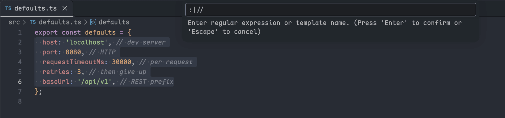
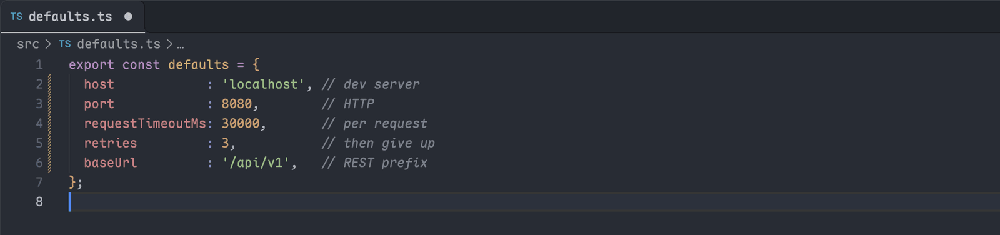

# 按正则对齐

[English](../../docs/align-by-regex.md) · **简体中文**

本页说明怎样让选中的行按分隔符对齐，以及怎样保存常用的表达式；先选中要对齐的那几行。

## 对齐选中的行

选中若干行，执行 `文本工具箱: 按正则对齐`，输入正则表达式或已保存模板的名字。选择器会把模板连同表达式一起列出来，不用记名字。





对齐作用于主选区覆盖的整行；选区停在下一行第 0 列时，不会把那一行带进来。列宽按 `editor.tabSize` 计算。

输入框会预填本窗口上一次用过的表达式。想每次都从空白开始：

```json
{ "textToolkit.advanced": { "alignByRegex.rememberLastInput": false } }
```

## 保存模板

模板写在 `textToolkit.alignByRegex.templates` 里，键是名字，值是表达式：

```json
{ "textToolkit.alignByRegex.templates": { "assign": "=|,|:", "arrow": "=>" } }
```

快捷键可以直接传入任一形式：`{ "regex": "=" }` 或 `{ "template": "assign" }`。

## 列宽怎样计算

每一列的宽度取该分隔符前最长的那段文本，只在含有这个分隔符的行之间比较：

```text
# 对齐前                # 对齐后
const a = 1;            const a  = 1;
let bbbb = 22;          let bbbb = 22;
var cc = 333;           var cc   = 333;
```

**各行的匹配数量不必相同。** 短行不会撑宽与它无关的列，只有一行够得着的列保持原样：

```text
# 对齐前                # 对齐后
x = 111111111;          x  = 111111111;
yy = 2; zzz = 3;        yy = 2; zzz   = 3;
w = 4; vvvvv = 5;       w  = 4; vvvvv = 5;
```
