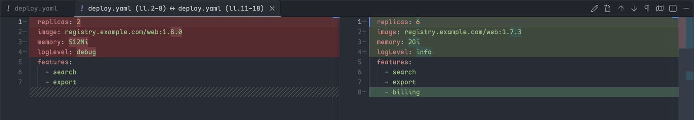

# 比较两段文本

[English](../../docs/compare.md) · **简体中文**

本页列出发起比较的全部方式，说明怎样编辑比较结果、怎样屏蔽噪声；两侧都不需要先存成文件。



## 发起比较

不论比较什么，两侧默认都以只读方式显示在 VS Code 自带的 diff 编辑器里，除非[把比较改成可编辑副本](#把比较改成可编辑副本)；按手头的内容在下表找到对应的一行。

| 想比较                               | 怎么做                                                               |
| ------------------------------------ | -------------------------------------------------------------------- |
| 两段选区，同一文件或不同文件         | 在第一段上执行 `标记待比较文本`，再在第二段上执行 `与标记的文本比较` |
| 一段选区和剪贴板                     | `与剪贴板比较`                                                       |
| 屏幕上分屏显示的两个文件             | `比较两个可见编辑器`                                                 |
| 任意两个已打开的标签页，可见与否都行 | `比较两个已打开的标签页`，然后依次选左侧和右侧                       |
| 把上一次比较左右对调                 | `交换比较两侧`                                                       |

没有选区时，比较命令使用整个文件。多光标时，各段非空选区按文档顺序用换行连接。标记会一直保留到被替换或清除，所以可以在一个文件里标记，到另一个文件里比较。

剪贴板默认放在左侧；把 `textToolkit.diff.clipboardSide` 设为 `right` 可换到右侧。`交换比较两侧` 只对调单次比较，不改这项设置。

每一侧沿用来源文件的语言，剪贴板一侧借用另一侧的语言，所以剪贴板与一段 `.ts` 选区比较时按 TypeScript 高亮。

## 看懂状态栏和标题

存在标记时，状态栏有一项显示标记的来源和行号范围，以及当前生效的归一化规则数。点击它打开比较选择器：标记、比较、交换、切换规则、清理副本、清除标记。

diff 标题里出现 `~`（而不是 `↔`），表示这次比较打开时至少有一条归一化规则生效。标题是打开那一刻的快照；状态栏里的计数才是当前值。

`textToolkit.diff.contextMenu` 决定编辑器右键菜单显示哪些比较项：`both`（默认）、`markOnly` 或 `none`。

## 把比较改成可编辑副本

点 diff 编辑器标题栏的 `✎`，或在比较选择器里选 `把当前比较改成可编辑副本`，两侧就都能编辑。得到什么取决于比较的对象：

- 两个完整文件（两侧都没有选区）：直接打开真实文件的原生可编辑 diff。改动存回磁盘，Git 集成照常工作，不产生副本。
- 其他情况，例如选区、剪贴板或只读的 `git:` 文档：在扩展的存储目录里写出两个副本文件，按来源命名，例如 `service (ll.3-7).ts` 和 `Clipboard.ts`。**编辑永远不会写回**原来的文本。

| 情形           | 行为                                                                                      |
| -------------- | ----------------------------------------------------------------------------------------- |
| 保存           | `Ctrl+S` 保存的是副本文件；想放到别处请用 `文件: 另存为`                                  |
| 关闭           | 副本打开时是干净的，改动之后关闭才会询问是否保存                                          |
| 标题           | 以 `✎ ` 开头，不会被误认成只读比较                                                        |
| 语法高亮       | 取决于副本的文件名；没有扩展名的一侧借用另一侧的扩展名                                    |
| 归一化规则     | 只在写出副本时套用一次；之后切换规则不会覆盖你的编辑                                      |
| `交换比较两侧` | 对调同样的两个文件，未保存的编辑仍在                                                      |
| 回到来源       | `✎` 旁边的跳转文件按钮，或选择器里的 `打开来源文件`，会打开来源文件并选中参与比较的那几行 |
| 清理           | 副本会一直保留，直到执行 `文本工具箱: 清理比较副本文件`；清理前先关掉副本标签页           |

## 用归一化规则屏蔽噪声

归一化规则只改写 diff 里显示的内容，从不改动文件，于是时间戳、制表符、空格不一致这类差异不再显示为变化：

```json
{
	"textToolkit.diff.normalizationRules": [
		{ "name": "Replace tabs with spaces", "match": "\t", "replaceWith": "  " },
		{ "name": "One space after a comma", "match": ",\\s*([^,\n]+)", "replaceWith": ", $1" },
		{
			"name": "Ignore letter case",
			"match": ".*",
			"replaceWith": { "letterCase": "upper" },
			"enableOnStart": false
		}
	]
}
```

| 字段            | 必填 | 含义                                                                                                            |
| --------------- | ---- | --------------------------------------------------------------------------------------------------------------- |
| `match`         | 是   | 正则表达式，自动加上全局标志                                                                                    |
| `replaceWith`   | 是   | 替换文本，`$1`、`$2`……对应捕获组；或写 `{ "letterCase": "upper" \| "lower" }`，把匹配到的内容统一转成大写或小写 |
| `name`          | 否   | 显示在规则切换选择器中                                                                                          |
| `enableOnStart` | 否   | 设为 `false` 时规则默认关闭，需要手动开启；缺省为 `true`                                                        |

规则按数组顺序依次应用。`切换归一化规则` 在运行时启停规则，不改设置，并立即刷新所有已打开的只读比较。在 `settings.json` 里改动这个数组，会让每条规则回到各自的 `enableOnStart`。`match` 不是合法正则或缺少必填字段的规则会被跳过，不会让整个功能失效，见[故障排查](troubleshooting.md#归一化规则没有生效)。

## 用好 diff 编辑器自带的能力

比较结果就是 VS Code 原生的 diff 编辑器，它自带的功能无需额外设置：

| 想要                       | 用什么                                                           |
| -------------------------- | ---------------------------------------------------------------- |
| 跳到下一处或上一处差异     | `F7` / `Shift+F7`                                                |
| 折叠没有变化的区域         | `diffEditor.hideUnchangedRegions.enabled`                        |
| 改成上下内联显示           | `diffEditor.renderSideBySide`，或 diff 编辑器里的 `⋯` 菜单       |
| 换一套 diff 配色           | 颜色主题，或 `workbench.colorCustomizations` 里的 `diffEditor.*` |
| 在资源管理器里比较两个文件 | 内置的 `选择以进行比较` / `与已选项目进行比较`                   |
| 和磁盘上已保存的版本比较   | 内置的 `文件: 将活动文件与已保存文件进行比较`                    |
